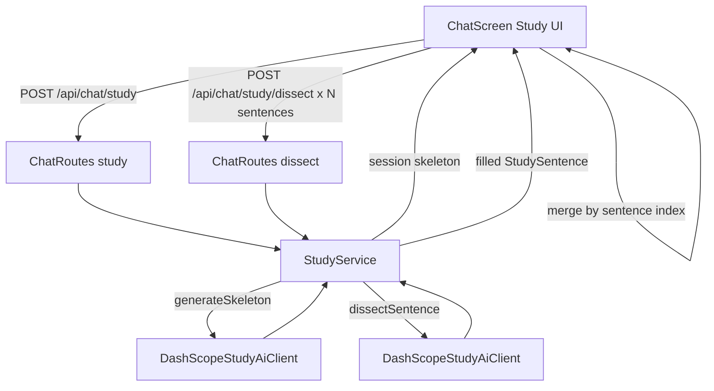

# Requirements

### Overview & Goals
Make study sessions feel instant by returning a lightweight tokenized skeleton first, then filling full word dissections sentence-by-sentence in the background. Learners should enter the study UI as soon as tokenization is ready, without waiting for every meaning/example payload.

### Scope
#### In Scope
- Split the current one-shot `POST /api/chat/study` AI generation into:
  1. **Skeleton**: language detection + sentence split + tokenization (no full dissections)
  2. **Per-sentence dissect**: full token details for one sentence
- Client-orchestrated parallel follow-up requests after the skeleton arrives
- Progressive study bottom-sheet UI (pending / ready / failed per sentence)
- Per-sentence retry when a dissect call fails
- Harden Qwen study JSON parsing against malformed model output (see production `JsonDecodingException` on `$.sentences[1]`)
- Keep existing study features: tappable tokens, full dissection panel, sentence TTS, localization, in-memory cache

#### Out of Scope
- SSE / WebSocket streaming transport
- Server-side study job store or session persistence
- Changing TTS behavior beyond starting earlier once sentence text is known
- Changing the Language Study mini-app chat payload

### User Stories
- As a learner, I want the study sheet to open with readable, tokenized text quickly so I can start exploring immediately.
- As a learner, I want word meanings to fill in shortly after open so I can dissect vocabulary without a long blocked spinner.
- As a learner, if one sentence fails to load details, I want to retry just that sentence and keep studying the rest.

### Functional Requirements
1. Tapping **Study** opens the bottom sheet immediately and shows a short loading state only until the **skeleton** returns.
2. Skeleton response includes `textLanguageTag`, ordered sentences, and ordered tokens. Lexical tokens are marked pending; punctuation/non-lexical tokens are plain.
3. As soon as the skeleton is shown:
   - Sentence play buttons can load TTS (sentence text is already known)
   - Client fires dissect requests for each sentence (parallel, modest concurrency)
4. When a sentence dissect succeeds, its tokens become tappable and show full detail (literal meaning, register, contextual meaning, near synonyms, 3 examples).
5. Pending lexical tokens are visible but not fully interactive (or open a lightweight “loading meaning…” state if tapped).
6. Failed sentence dissections keep the tokenized sentence visible and show a local retry control; other sentences stay usable.
7. Cache stores progressive updates; reopening a message resumes from cache and only refetches missing/failed sentences.
8. Blank study text still returns `400` as today.

### Non-Functional Requirements
- Skeleton AI call must be small/fast enough to avoid the current 120s DashScope timeout in normal chat-message lengths.
- Each dissect call covers **one sentence** only, keeping output size bounded.
- Preserve existing REST + JSON patterns (no new streaming stack).
- Partial failure must not wipe successful skeleton/dissection data.
- Study AI parsers must tolerate common Qwen JSON drift (extra keys, non-object array elements, fenced markdown) without failing the whole session when salvageable content exists.

# Technical Design

### Current Implementation
- One blocking path: `ChatScreen.openStudy` → `ChatApi.study` → `POST /api/chat/study` → `StudyService.study` → `DashScopeStudyAiClient.generate`.
- `DashScopeStudyAiClient` asks Qwen for **all** sentences + **full** token dissections in one JSON object (`QwenStudyClient.kt`).
- `QwenStudyReplyParser` decodes the full payload via strict kotlinx serializers (`QwenStudyWire` / `QwenStudySentenceWire`). Any non-object element in `sentences` hard-fails the whole request.
- Production failure already observed: `JsonDecodingException: Expected start of the object '{', but had '"' instead at path: $.sentences[1]` with trailing garbage resembling `}]},"sentences"  ]}` — model emitted a string (or broken nesting) where a sentence object was required.
- Shared HTTP client timeout is 120s (`ChatSystem.kt`), matching the observed DashScope timeout.
- UI (`StudySessionDialog` / `StudySessionContent` in `ChatScreen.kt`) only renders content after the full `StudySessionResponse` arrives.
- `StudyToken.isDissectable` is derived from non-empty dissection fields, so pending words and punctuation currently cannot be distinguished.

### Key Decisions
1. **Client-orchestrated progressive REST** (chosen): skeleton endpoint + per-sentence dissect endpoint. Matches existing Ktor/JSON style; no SSE infra.
2. **Dissection unit = one sentence**: fewer round-trips than per-token; whole sentence becomes ready together.
3. **Explicit lexical/pending state on tokens**: add a stable flag/state so punctuation stays plain while unloaded words show pending UI.
4. **Bounded parallel dissect fan-out** (e.g. 2–3 in flight): start remaining sentences immediately without stampeding DashScope.
5. **Per-sentence retry**: failures are local; successful sentences remain.
6. **Lenient AI JSON salvage**: parse skeleton/dissect replies element-by-element (JsonElement walk), skip invalid sentence/token entries, require at least one valid unit; tighter prompts + smaller payloads reduce malformation rate.

### Architecture Diagram


### Proposed Changes

#### 1) Shared API contracts (`core/.../ChatApiModels.kt`)
Keep `StudySessionRequest` / `StudySessionResponse` / `StudySentence` / `StudyToken`, and extend them for progressive loading:

```kotlin
enum class StudyTokenStatus { PLAIN, PENDING, READY, ERROR }

// StudyToken gains:
val status: StudyTokenStatus = StudyTokenStatus.READY
// existing dissection fields remain; empty while PENDING/PLAIN

// isDissectable becomes status == READY && has detail fields
// (or simply status == READY)

data class StudyDissectSentenceRequest(
    val text: String,                 // full source text for context
    val sentenceText: String,
    val tokens: List<String>,         // ordered token texts from skeleton
    val textLanguageTag: String,      // source language from skeleton
    val languageTag: String,          // learner UI language for explanations
)

data class StudyDissectSentenceResponse(
    val sentenceText: String,
    val tokens: List<StudyToken>,     // same order/text, status READY/PLAIN
)
```

Skeleton response shape stays `StudySessionResponse`, but lexical tokens start as `PENDING` with empty dissection fields.

#### 2) Server AI + service split
**Files:** `StudyService.kt`, `QwenStudyClient.kt`

Replace single `StudyAiClient.generate` with two operations:

```kotlin
interface StudyAiClient {
    suspend fun generateSkeleton(request: StudyGenerationRequest): StudySessionResponse
    suspend fun dissectSentence(request: StudyDissectGenerationRequest): StudySentence
}
```

- `StudyService.skeleton(...)` validates input, calls `generateSkeleton`, normalizes, forces lexical tokens to `PENDING` / plain tokens to `PLAIN`.
- `StudyService.dissectSentence(...)` validates token list non-empty, calls AI, normalizes, and **re-aligns** returned tokens to the requested ordered token texts (reject/repair obvious mismatches).
- `DashScopeStudyAiClient`:
  - **Skeleton prompt**: detect language, split sentences, tokenize only. Tiny JSON schema — no meanings/examples. Emphasize: `sentences` is an array of objects only; never strings; no duplicate top-level keys.
  - **Dissect prompt**: given one sentence + ordered tokens + learner language, return full dissection fields for each token; punctuation stays empty/`PLAIN`; examples remain in source language; meanings in learner language. Schema is a single sentence object (or `{sentenceText, tokens}`) — much smaller than today’s multi-sentence full payload, which is the main malformation source.
- Replace strict `decodeFromString<QwenStudyWire>` with **lenient parsers** (`QwenStudySkeletonParser` / `QwenStudyDissectParser`):
  - Strip fenced markdown as today.
  - Parse root as `JsonObject`.
  - Walk `sentences` (skeleton) or `tokens` (dissect) as `JsonArray`; **skip** non-object elements and objects missing required `text`.
  - Only fail if zero valid sentences/tokens remain after salvage.
  - Add unit tests using the production-shaped bad fragment (string at `sentences[1]`, trailing junk keys) to prove salvage/skip behavior.

#### 3) Routes (`ChatRoutes.kt`, `Application.kt` wiring unchanged aside from new route)
- `POST /api/chat/study` → skeleton only (breaking change from full payload; acceptable — feature is new and client-owned).
- `POST /api/chat/study/dissect` → one-sentence dissection.
- Bad request handling mirrors existing chat/study validation via `ChatErrorResponse`.

#### 4) Web API (`ChatApi.kt`)
```kotlin
suspend fun study(request: StudySessionRequest): StudySessionResponse // skeleton
suspend fun studyDissect(request: StudyDissectSentenceRequest): StudyDissectSentenceResponse
```

#### 5) Progressive UI (`ChatScreen.kt`, `Styles.kt`, `Localization.kt`)
State model evolution in `openStudy`:
- `studySession`: skeleton/merged session
- `studySentenceStatus: Map<Int, SentenceLoadState>` where `Loading | Ready | Error`
- `studyLoading`: true only while waiting for skeleton
- On skeleton success: show content immediately, then `coroutineScope` + limited parallelism over sentences calling `ChatApi.studyDissect`
- Merge strategy: replace `session.sentences[i].tokens` with dissected tokens; mark READY; update `studyCache[messageId]`
- On dissect failure: mark sentence ERROR; keep pending tokens; show retry chip under that sentence only
- Retry re-invokes dissect for that sentence index only
- Token UI:
  - `PLAIN` → non-interactive span (current plain style)
  - `PENDING` → muted token chip / not selected; optional tap shows “loading meaning”
  - `READY` → existing tappable token + detail panel
  - `ERROR` on sentence → retry control; tokens remain visible
- TTS `LaunchedEffect` keys off skeleton sentence texts so audio can warm up before dissections finish
- Language change still clears cache and restarts skeleton flow

New strings (all 6 UI languages), e.g.:
- `chatStudyPreparingMeanings`
- `chatStudySentenceError`
- `chatStudyRetrySentence`
- `chatStudyMeaningLoading`

#### 6) Docs
Update `AI_CHAT_AND_MINI_APPS.md` study-session section to describe skeleton + per-sentence dissect flow.

### File Structure
**Modify**
- `core/src/commonMain/kotlin/apap/oneverandah/api/ChatApiModels.kt`
- `core/src/commonTest/kotlin/apap/oneverandah/api/ChatApiModelsTest.kt`
- `server/src/main/kotlin/apap/oneverandah/chat/StudyService.kt`
- `server/src/main/kotlin/apap/oneverandah/chat/QwenStudyClient.kt`
- `server/src/main/kotlin/apap/oneverandah/routes/ChatRoutes.kt`
- `server/src/test/kotlin/apap/oneverandah/chat/StudyServiceTest.kt`
- `server/src/test/kotlin/apap/oneverandah/chat/ChatRoutesTest.kt`
- `app/web/src/jsMain/kotlin/apap/oneverandah/api/ChatApi.kt`
- `app/web/src/jsTest/kotlin/apap/oneverandah/api/ChatApiTest.kt`
- `app/web/src/jsMain/kotlin/apap/oneverandah/screens/ChatScreen.kt`
- `app/web/src/jsMain/kotlin/apap/oneverandah/Styles.kt`
- `app/web/src/jsMain/kotlin/apap/oneverandah/i18n/Localization.kt`
- `AI_CHAT_AND_MINI_APPS.md`

### Risks
- **Token alignment drift**: dissect AI may alter token boundaries vs skeleton. Mitigate by sending exact token list and post-validating order/text equality; on mismatch, fail that sentence for retry rather than corrupting UI.
- **Rate limits / parallel storms**: cap in-flight sentence dissects (2–3).
- **Single long sentence**: still one large dissect payload. Mitigate with tight prompt (“exactly these tokens”, short examples). If needed later, split into token batches without changing the skeleton UX.
- **Cache inconsistency**: always replace whole sentence atomically on success; never partially merge tokens inside a sentence.
- **Malformed AI JSON**: already seen in production on full multi-sentence replies. Mitigate with smaller skeleton/dissect schemas + element-wise lenient parsing; never let one bad array element discard the whole valid prefix.

# Testing

### Validation Approach
Prefer focused unit/route tests and a production JS compile, matching the previous study-feature verification style.

### Key Scenarios
1. **Skeleton contract**: blank text rejected; non-blank returns ≥1 sentence with ordered tokens in `PENDING`/`PLAIN` only (no required dissection fields).
2. **Dissect contract**: returns same token texts/order with lexical tokens `READY` and populated fields; punctuation stays `PLAIN`.
3. **Normalization**: trim/dedupe synonyms/examples; language tags normalized via `Language.fromTag`.
4. **Routes**: `POST /api/chat/study` and `POST /api/chat/study/dissect` happy-path + 400 validation (`ChatRoutesTest`).
5. **Parsers**: fenced JSON accepted; empty sentences/tokens rejected; malformed `sentences`/`tokens` array elements skipped (cover production `$.sentences[1]` string case); fully empty salvage still rejected.
6. **Client API**: `ChatApi.study` + `ChatApi.studyDissect` encode/decode paths (`ChatApiTest` if present patterns allow).
7. **Compile**: `:app:web:compileProductionExecutableKotlinJs` succeeds with progressive UI state.

### Edge Cases
- One-sentence source text still uses skeleton + single dissect (two small calls).
- Multi-sentence: one dissect failure leaves others READY and exposes sentence retry.
- Reopen cached partial session resumes only non-READY sentences.
- AI token mismatch on dissect → sentence error, not crash.

### Test Changes
- Update `StudyServiceTest` fakes for `generateSkeleton` / `dissectSentence`.
- Extend `ChatApiModelsTest` for new request/response + token status behavior.
- Extend `ChatRoutesTest` with dissect route coverage.
- No separate end-to-end browser test required unless already easy in-repo.

# Delivery Steps

### ✓ Step 1: Split study API into skeleton + sentence dissect contracts
Shared models and server routes support a fast skeleton response plus one-sentence dissection; Qwen parsers no longer die on one bad array element.

- Extend `ChatApiModels.kt` with `StudyTokenStatus`, dissect request/response types, and progressive-friendly `StudyToken` defaults.
- Update `StudyToken.isDissectable` (or equivalent) so READY lexical tokens are interactive while PENDING/PLAIN are not confused.
- Change `StudyAiClient` / `StudyService` to `skeleton` + `dissectSentence` with normalization and token-alignment checks.
- Rewrite `DashScopeStudyAiClient` prompts/parsers into small skeleton JSON and per-sentence dissect JSON with **lenient JsonElement walking** (skip non-object `sentences`/`tokens` entries; require ≥1 valid unit).
- Add parser unit tests for the production malformation (`sentences[1]` as string / trailing junk) and happy paths.
- Wire `POST /api/chat/study` (skeleton) and `POST /api/chat/study/dissect` in `ChatRoutes.kt`.
- Cover models/service/routes with unit tests (`ChatApiModelsTest`, `StudyServiceTest`, `ChatRoutesTest`).

### ✓ Step 2: Add client API and progressive study-session UI
The study bottom sheet opens on skeleton data and fills meanings sentence-by-sentence with local retry.

- Add `ChatApi.studyDissect` and keep `ChatApi.study` as the skeleton call.
- Refactor `openStudy` / `StudySessionDialog` / `StudySessionContent` to track per-sentence loading/ready/error state.
- After skeleton success, fan out bounded parallel dissect calls; merge each sentence atomically into session + cache.
- Render PENDING vs READY vs PLAIN tokens; show per-sentence retry on ERROR; allow TTS from skeleton sentence text.
- Add localized strings + light styles for pending/error/retry affordances.
- Update `AI_CHAT_AND_MINI_APPS.md` and verify with targeted server tests + JS compile.