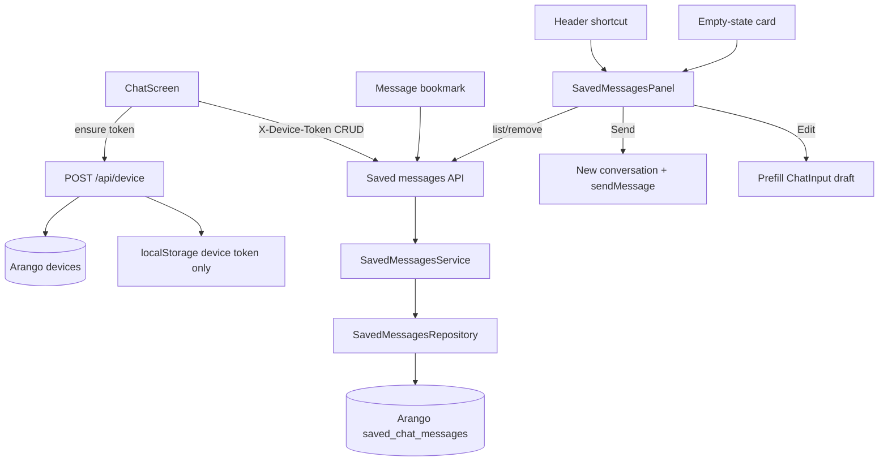

# Requirements

### Overview & Goals
Allow users (no accounts) to bookmark any chat message — theirs or the AI’s, including mini-app payloads — into a **Saved messages** area inside chat, then restart a conversation from a saved item via **Send** or **Edit**.

Only a long **device token** lives in browser `localStorage`. All saved messages are stored on the backend and scoped by that token.

### Scope
#### In Scope
- Server-issued device identity (`POST /api/device`) persisted client-side as a single token
- Backend CRUD for saved chat messages keyed by device token
- Save/unsave controls on every chat bubble (user + AI)
- In-chat Saved list reachable from **header shortcut** and **empty-state card** (same panel component)
- Restart actions: **Send now** (auto-send as new user message) and **Edit** (prefill draft)
- Persist message text, sender, timestamps, optional `miniApp`, and follow-ups
- i18n strings + toast feedback consistent with offer bookmark UX

#### Out of Scope
- User accounts / cross-device sync beyond the single browser token
- Saving full conversation threads (message-level only)
- Resuming the original `conversationId` when restarting
- Admin tooling for device revocation UI (schema should allow it later)
- Changing Qwen/chat generation behavior

### User Stories
- As a guest, I want to bookmark a useful AI or user message so I can find it later on this device.
- As a guest, I want to open Saved from chat (empty state or header) and browse my bookmarks with mini-apps still visible.
- As a guest, I want to **Send** a saved message to start a fresh chat immediately, or **Edit** it in the composer first.
- As a guest, I want my bookmarks to survive browser restarts without filling `localStorage` with message bodies.

### Functional Requirements
1. On first need, the client obtains a server-issued device token and stores only that token locally.
2. All saved-message API calls send `X-Device-Token`; unauthorized/missing token → `401`.
3. Bookmark on a message toggles save for that device; filled bookmark when already saved (match by `sourceMessageId` when present).
4. Saved panel lists newest-first items with sender label, text preview, optional mini-app render, **Send**, **Edit**, and **Remove**.
5. **Send** closes the panel, starts a **new** conversation (clears current `conversationId`/transcript as needed), and auto-sends the saved text (same path as `pendingChatMessage` / `sendMessage`).
6. **Edit** closes the panel and puts the saved text into the chat draft without sending.
7. Backend stores full snapshot including `miniApp` so language-study / resident / fact cards can re-render offline from the API payload.
8. Soft per-device cap (e.g. 100 newest); exceeding cap drops oldest on insert.

### Non-Functional Requirements
- Device token: cryptographically strong, long opaque string (e.g. 32 random bytes, URL-safe base64).
- Production uses ArangoDB; dev keeps in-memory fallback like existing chat history.
- Persistence failures surface a toast; chat send path remains usable if saved APIs fail.
- Do not log raw device tokens.
- CORS must allow `X-Device-Token`.

# Technical Design

### Current Implementation
- Chat UI: `app/web/.../screens/ChatScreen.kt` — ephemeral in-memory transcript; optional `initialMessage` auto-send.
- Routing seed: `Main.kt` `pendingChatMessage` → `/chat`.
- API models: `core/.../api/ChatApiModels.kt` (`ChatMessage`, `ChatMiniApp`, …).
- Server chat: `ChatRoutes` / `ChatService` / `ArangoChatRepository` (`chat_messages` by `conversationId`).
- Client API: `ChatApi` object + Ktor JS client.
- Local persistence pattern today: `PinnedStore` / `AdminAuth` (Compose state + `localStorage`) — **reuse only for the device token**, not message bodies.
- Toasts: `Toaster` + offer save copy in `Localization`.
- Scaffold/AppBar: no custom action slot yet (`Components.kt`).

### Key Decisions
1. **Server-issued device token** via `POST /api/device`; client stores token under e.g. `oneverandah.deviceToken`; requests use `X-Device-Token`.
2. **Saved messages live only on the backend**, scoped by device; Arango collection `saved_chat_messages` (+ `devices` for issuance/last-seen/future revoke).
3. **In-chat dual entry**: header bookmark + empty-state explore card share one `SavedMessagesPanel`.
4. **Restart = fresh chat seed by text** (Send/Edit); mini-apps are for browsing saved context, not re-injected into the new conversation.
5. **Dedupe by `sourceMessageId` per device** when saving from the live transcript; manual re-saves of the same id update `savedAt` / payload instead of duplicating.

### Architecture Diagram


### Data Models / Contracts
Shared in `core` (names indicative):

```kotlin
@Serializable
data class DeviceTokenResponse(val deviceToken: String)

@Serializable
data class SaveChatMessageRequest(
    val sourceMessageId: String? = null,
    val sender: ChatSender,
    val text: String,
    val createdAt: Long,
    val miniApp: ChatMiniApp? = null,
    val followUpQuestions: List<String> = emptyList(),
)

@Serializable
data class SavedChatMessage(
    val id: String,
    val sourceMessageId: String? = null,
    val sender: ChatSender,
    val text: String,
    val createdAt: Long,
    val savedAt: Long,
    val miniApp: ChatMiniApp? = null,
    val followUpQuestions: List<String> = emptyList(),
)

@Serializable
data class SavedChatMessagesResponse(val items: List<SavedChatMessage>)
```

**HTTP**
 Method | Path | Auth | Behavior |
 --- | --- | --- | --- |
 `POST` | `/api/device` | none | Create device row; return token once |
 `GET` | `/api/chat/saved` | `X-Device-Token` | List newest-first for device |
 `POST` | `/api/chat/saved` | `X-Device-Token` | Upsert by `sourceMessageId` if set; else insert; enforce cap |
 `DELETE` | `/api/chat/saved/{id}` | `X-Device-Token` | Delete only if owned by device |

Server document shape adds internal `deviceToken` (or `deviceId` FK); **strip from responses**.

Token validation: lookup `devices` by token (store token hash as `_key` or dedicated field; prefer hash-at-rest). Reject unknown/revoked tokens with `401`.

### Proposed Changes
#### Backend
- `DeviceService` + `DeviceRepository` (Arango + in-memory): issue token, `touch` lastSeen, `findValid`.
- `SavedMessagesService` + `SavedMessagesRepository`: list/save/delete with ownership checks and cap.
- `ArangoSavedMessagesRepository` / `ArangoDeviceRepository` following `ArangoChatRepository` patterns (`ensureSchema`, persistent indexes on `deviceToken` + `savedAt`, optional unique index on `[deviceToken, sourceMessageId]`).
- Wire into `ChatSystem` (or small `DeviceSystem`) and `Application.kt` routing; extend `chatRoutes` (or adjacent route module).
- CORS: `allowHeader("X-Device-Token")` in `Application.kt`.
- Tests: route/service tests mirroring `ChatRoutesTest` / `ChatServiceTest` (issue token → save → list → delete; cross-device isolation).

#### Client
- `state/DeviceTokenStore.kt`: load/create token via API; expose `suspend fun ensureToken(): String`.
- Extend `ChatApi` (or small `DeviceApi` + saved methods) to attach `X-Device-Token` on saved endpoints and call `POST /api/device`.
- `ChatScreen`:
  - Load saved id set for bookmark filled state
  - Bookmark control on `ChatMessageView`
  - Empty-state “Saved messages” card beside Phrases/Stories
  - Header action opens panel
  - `SavedMessagesPanel` with list, mini-app preview (reuse existing card composables), Send / Edit / Remove
  - Send → reset conversation state + `sendMessage(text)`; Edit → `draft = text`
- Extend `Scaffold`/`AppBar` with optional trailing action (e.g. `appBarAction: (@Composable () -> Unit)?` or icon+callback) so chat can show the Saved shortcut without global nav clutter.
- Styles for panel, bookmark chip, empty card; i18n keys for titles, actions, empty list, errors, toasts.

### Components
 Component | Role |
 --- | --- |
 `DeviceTokenStore` | Sole localStorage citizen for identity |
 `DeviceService` / routes | Issue & validate devices |
 `SavedMessagesService` / repo / routes | Backend source of truth |
 `ChatApi` (+ device header helper) | Browser access |
 `ChatMessageView` bookmark | Save/unsave |
 `SavedMessagesPanel` | Shared list UI |
 `ChatEmptyState` card | Discovery entry |
 `AppBar` action slot | Always-available entry during a conversation |

### File Structure
**Add**
- `core/.../api/SavedChatApiModels.kt` (or extend `ChatApiModels.kt`)
- `server/.../chat/DeviceRepository.kt`, `DeviceService.kt`, `SavedMessagesRepository.kt`, `SavedMessagesService.kt`
- `server/.../chat/ArangoDeviceRepository.kt`, `ArangoSavedMessagesRepository.kt` (or combined Arango helper)
- `server/src/test/...` coverage for device + saved routes/services
- `app/web/.../state/DeviceTokenStore.kt`
- Optional `app/web/.../components/SavedMessagesPanel.kt` if extracted from `ChatScreen`

**Modify**
- `server/.../routes/ChatRoutes.kt`, `chat/ChatSystem.kt`, `Application.kt`
- `app/web/.../api/ChatApi.kt`
- `app/web/.../screens/ChatScreen.kt`
- `app/web/.../components/Components.kt` (Scaffold/AppBar action)
- `app/web/.../Styles.kt`, `i18n/Localization.kt`
- `AI_CHAT_AND_MINI_APPS.md` short note on saved messages + device token

### Risks
 Risk | Mitigation |
 --- | --- |
 Token loss clears access to saves | Expected for accountless design; document clearly in empty/error copy |
 Token theft if XSS | Same as any bearer in localStorage; keep token long, no privileged admin scope |
 Mini-app serialization drift | Reuse shared `ChatMiniApp` serializers end-to-end |
 Arango unavailable in dev | In-memory repos like chat history |
 Quota / abuse | Per-device cap; optional basic rate limit later |

# Testing

### Validation Approach
- Server unit/route tests with in-memory repositories (primary automated coverage).
- Manual/UI verification on web chat flows where JS tests are thin.

### Key Scenarios
1. `POST /api/device` returns a long token; repeat calls without client storage create distinct devices.
2. Save message with valid token → appears in `GET /api/chat/saved` newest-first with `miniApp` intact.
3. Save same `sourceMessageId` twice → single row updated, not duplicated.
4. Delete requires owning device; other device token cannot list/delete foreign items.
5. Missing/invalid `X-Device-Token` → `401` on saved endpoints.
6. Cap: inserting beyond limit removes oldest for that device.
7. Client: ensure token once; bookmark toggles; panel Send auto-sends on fresh conversation; Edit prefills draft; empty-state and header both open the same panel.

### Edge Cases
- Blank text rejected on save.
- AI message with each mini-app type round-trips.
- Saved APIs failing mid-session show toast; chat still works.
- Clearing site data issues a new device token and an empty saved list.

### Test Changes
- Add `DeviceRoutesTest` / `SavedMessagesServiceTest` (names flexible).
- Extend or add client tests only if existing `ChatApiTest` patterns make header injection easy; otherwise rely on server tests + manual UI check.

# Delivery Steps

### ✓ Step 1: Device identity API and client token store
Browsers can obtain a server-issued device token and persist only that token locally.

- Add shared `DeviceTokenResponse` (and any tiny device DTOs) in `core` API models.
- Implement `DeviceRepository` + `DeviceService` with Arango + in-memory implementations; generate a long opaque token and record created/lastSeen (revocation-ready).
- Expose `POST /api/device` and wire it through `ChatSystem`/`Application`.
- Allow CORS header `X-Device-Token`.
- Add `DeviceTokenStore` on web (`localStorage` key only) with `ensureToken()` calling the API when missing.
- Cover issue + validation paths with server tests.

### ✓ Step 2: Backend saved-messages persistence and routes
Saved chat messages are stored server-side and scoped strictly by device token.

- Add shared `SaveChatMessageRequest`, `SavedChatMessage`, `SavedChatMessagesResponse` models (include `miniApp` / follow-ups).
- Implement `SavedMessagesRepository` + `SavedMessagesService`: list, upsert-by-`sourceMessageId`, delete-with-ownership, soft cap (~100).
- Arango collection `saved_chat_messages` with indexes on `deviceToken` (+ `savedAt`, optional unique `[deviceToken, sourceMessageId]`).
- Routes: `GET/POST /api/chat/saved`, `DELETE /api/chat/saved/{id}` requiring valid `X-Device-Token`.
- Tests for isolation, upsert, delete ownership, cap, and auth failures.

### ✓ Step 3: ChatApi saved endpoints and ChatScreen save/restart UI
Users can bookmark messages in chat and restart from Saved via Send or Edit.

- Extend `ChatApi` to ensure device token and call saved CRUD with `X-Device-Token`.
- Extend `Scaffold`/`AppBar` with an optional chat-only Saved action.
- Update `ChatMessageView` with save/unsave bookmark + filled state from loaded saved ids.
- Add shared `SavedMessagesPanel` (header + empty-state card entry): list, mini-app preview via existing cards, Send / Edit / Remove.
- Wire Send to fresh conversation + `sendMessage(text)`; Edit to prefill `draft`.
- Styles, i18n, and toasts aligned with existing save UX; brief doc note in `AI_CHAT_AND_MINI_APPS.md`.