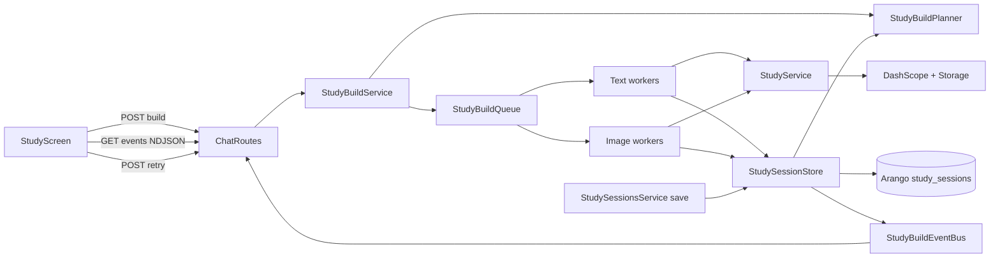

# Requirements

### Overview & Goals
Today the server only builds the study **skeleton** (`POST /api/chat/study` → `StudySessionsService.createFromStudyRequest`). The browser runs everything else from `StudyScreen.kt` on a Compose `rememberCoroutineScope`, so leaving the screen cancels it:
- dissections (`loadMissingStudyDissections`)
- word images (`loadMissingStudyWordImages`)
- cast and portraits (`ensureStudyCharacters`)
- sentence images (`loadMissingStudyImages`)
- Play scenarios (`loadMissingPlayScenarios`)
- the exam (`loadMissingExamScene`)

Image jobs do keep running in `StudyService.studyImages`, but that store is in-memory only. Their URLs reach the saved session only while the client is still polling and calling `persistStudySession` again.

**Goal:** the server builds the whole study session from a single request, and the build is not affected by what the client does. The client becomes a viewer that subscribes to progress and asks for a retry only after a hard failure.

### Scope
#### In Scope (server-owned end-to-end)
- Text prep: parse-mode **intent** and **translate** ("study in another language") run on the server too.
- Skeleton and session name.
- **Word meanings**: dissect every sentence.
- **Word images** for every dissectable token.
- **Cast + portraits**, then **sentence images** that use the portraits as references.
- **Play scenarios + cover images**.
- **Exam scene** (10 rounds).
- Builds survive a server restart (resume), with automatic retries for transient failures and a manual retry per element.
- Live progress pushed to open clients over an NDJSON stream.

#### Out of Scope
- Interactive, user-driven generation: Play turns (`/study/play/turn`), playground judgments, express/listen/write checks, exam scoring. These stay request/response.
- Multi-node distribution. The queue is single-node, like `images/QueueService`.
- Changing prompts or model choices.

### User Stories
- As a learner, I want to start a study session and leave, and find it fully built (meanings, images, Play, Test) when I come back.
- As a learner, I want progress to appear live while I watch, without refreshing.
- As a learner, I want a retry button only for elements that truly failed, and it should work even after I reopen the session.
- As an operator, I want unfinished builds to resume automatically after a deploy or restart.

### Functional Requirements
1. **Create:** `POST /api/chat/study/sessions/build` returns the persisted session id within one fast round trip (no AI call in the request path). Everything else runs in the background.
2. **Independence:** if the client closes the tab or navigates away right after create, every element above still ends up in the stored record, unless it failed hard.
3. **Order:**
   - prep → skeleton → (name, dissections, cast) in parallel
   - dissection[i] → word images for sentence i
   - main portrait settled → sentence images and Play scenarios → covers
   - all dissections and cast settled → exam
4. **Idempotency:**
   - Never regenerate a completed element (non-blank URL, READY token, ten-round exam).
   - Never run the same element twice at the same time.
   - Creating again for the same device + `sourceMessageId` + `languageTag` returns the existing session.
   - A different `languageTag` resets the record and rebuilds it.
5. **Retries:** up to 3 automatic attempts per element, with backoff of 2s, 10s and 30s. Images keep the existing "retry without references" fallback. After the attempts run out, the element is marked FAILED in the build state. `POST …/build/retry` clears it and re-queues it.
6. **Resume:**
   - On startup, every record whose build is not terminal is re-planned.
   - INTENT/TRANSLATE prep inputs are persisted until prep succeeds so those modes can resume after restart.
   - Opening a legacy session with missing content (owner or community) also triggers a build.
7. **Progress stream:** `GET /api/chat/study/sessions/{id}/events` streams NDJSON:
   - a snapshot first
   - then patch events
   - a heartbeat every 15s
   - `Done` when the build is terminal

   The client reconnects with backoff, and the snapshot on reconnect re-syncs its state.
8. **Client writes:** client saves (Play conversation history, practice sentences) are merged on the server and can never undo server-built fields.
9. **UI unchanged:** existing loading, failed and retry indicators in `StudySessionPane` keep working, now driven by the server's build state.

### Non-Functional Requirements
- Bounded concurrency through config (text workers default 4, image workers default 3). Interactive work (prep, skeleton, dissect, cast) runs before word images.
- Writes to the store are coalesced (≤750 ms per session) so a session with many tokens doesn't cause dozens of full-document Arango upserts.
- The stream does not use the client's 4-slot request semaphore and has no request timeout.

# Technical Design

### Current Implementation
- `ChatRoutes.kt` (L123–136): `POST /api/chat/study` → `StudySessionsService.createFromStudyRequest(token, req) { studyService.skeleton(it) }`. This persists only the skeleton.
- `StudyService.kt`: the element generators are request-scoped. `dissectSentence` (L306) also starts word-image jobs through `attachWordImageJob`. The others are `storyCharacters` (L372), `sentenceImage` (L413), `wordImage` (L448), `playScenarios` (L470) and `examScene` (L592). Image jobs go through `enqueueStudyImage` (L1001), which writes to the in-memory `studyImages` map in `ChatSystem.scope`.
- `StudySessionsService.save` upserts the **whole** client-sent session. The last writer wins, so a server-side writer would currently get overwritten.
- `StudyScreen.kt` (L222–1198): all orchestration, polling (`STUDY_IMAGE_POLL_*`) and `persistStudySession` re-saves.
- Patterns to reuse:
  - `images/QueueService` (Channel + N workers + `inFlight` dedupe + `resumeInterrupted`)
  - the NDJSON streaming in `/api/chat` (`respondTextWriter`, client `bodyAsChannel().readLine()`)
  - `ArangoStudySessionsRepository` for persistence

### Key Decisions
1. **Job queue + workers (your choice).** Each element is its own `StudyBuildTask`, processed by bounded worker pools, modeled on `QueueService`. Two pools (text / image), each with a high and a low priority channel, read through a biased `select`.
2. **Planner derived from content, not a task table.** `StudyBuildPlanner.plan(record)` works out the pending tasks from the session itself: PENDING tokens, missing URLs, empty cast or scenarios, a non-ten-round exam. The record stores a compact `build` state (status, attempts, failures) and the normalized prep request only while INTENT/TRANSLATE prep is pending. Resume, self-healing of legacy sessions and "what's next after X finishes" are all the same call. No extra Arango collection is needed.
3. **Single writer for content.** `StudySessionStore` owns read-modify-write for each session id (per-id `Mutex` + write-behind cache). Builder results and client saves both go through it. Client saves go through `StudySessionMerge`, which never downgrades server-built fields.
4. **Streaming = NDJSON over `respondTextWriter`** (the same mechanism as `/api/chat`, which works through the existing CORS/proxy setup), fed by an in-memory per-session `MutableSharedFlow` (`StudyBuildEventBus`). Events are idempotent "set" patches, so snapshot + live events can't double-apply.
5. **Image generation becomes awaitable.** The body of `enqueueStudyImage` is split out into `suspend fun renderStudyImage(prompt, refs, label): String`, keeping the refs→no-refs fallback. Workers await the URL and write it straight to the record. The legacy async endpoints keep using it through `scope.launch`.

### Data Models / Contracts
New in `core/.../api/ChatApiModels.kt` (all `@Serializable`, defaults kept backward compatible):
```kotlin
enum class StudyBuildMode { EXACT, INTENT, TRANSLATE }
data class StudyBuildRequest(
    val text: String, val languageTag: String,
    val sourceMessageId: String? = null,
    val mode: StudyBuildMode = StudyBuildMode.EXACT,
    val targetLanguageTag: String? = null,   // TRANSLATE
    val sourceLanguageTag: String? = null,
) { fun normalizedOrNull(): StudyBuildRequest? }

enum class StudyBuildElementKind { PREPARE, SKELETON, NAME, DISSECT, WORD_IMAGE, CHARACTERS,
    PORTRAIT, SENTENCE_IMAGE, PLAY_SCENARIOS, PLAY_COVER, EXAM }
data class StudyBuildElement(
    val kind: StudyBuildElementKind,
    val sentenceIndex: Int? = null, val tokenIndex: Int? = null,
    val characterId: String? = null, val scenarioId: String? = null,
) { val key: String }  // e.g. "WORD_IMAGE:2:3"

enum class StudyBuildStatus { PREPARING, BUILDING, COMPLETE, PARTIAL /* terminal with failures */ }
data class StudyBuildState(
    val status: StudyBuildStatus,
    val failed: List<StudyBuildElement> = emptyList(),
    val inFlight: List<StudyBuildElement> = emptyList(),   // transient, filled for API only
    val attempts: Map<String, Int> = emptyMap(),
    val updatedAt: Long = 0,
)

@Serializable sealed interface StudyBuildEvent {          // classDiscriminator = "type"
    data class Snapshot(val session: SavedStudySession)
    data class Skeleton(val session: StudySessionResponse)
    data class SentenceDissected(val index: Int, val sentence: StudySentence)
    data class WordImage(val sentenceIndex: Int, val tokenIndex: Int, val imageUrl: String)
    data class SentenceImage(val index: Int, val imageUrl: String)
    data class Characters(val characters: List<StudyStoryCharacter>)
    data class PlayScenarios(val scenarios: List<StudyPlayScenario>)
    data class ExamScene(val scene: StudyExamScene)
    data class Renamed(val name: String)
    data class Build(val state: StudyBuildState)
    data object Heartbeat; data object Done
}
data class StudyBuildRetryRequest(val elements: List<StudyBuildElement> = emptyList()) // empty = all failed
```
Modified:
- `SavedStudySession` gets `build: StudyBuildState? = null`. `null` means a legacy record.
- `SavedStudySessionRecord` / `SavedStudySessionDocument` get `build` and optional `buildRequest` metadata (cleared after prep succeeds); `SaveStudySessionRequest.normalizedOrNull` is unchanged. While the status is `PREPARING`, the record may have empty `sentences` (the session text is the raw input).
- `StudySessionsRepository` gets `listIncompleteBuilds(): List<String>` (ids whose `build.status` is PREPARING/BUILDING), in both the Arango and InMemory versions.

Endpoints (in `ChatRoutes.kt`, behind the device token):
- `POST /api/chat/study/sessions/build` with body `StudyBuildRequest`. Returns `SavedStudySession` (202).
- `GET  /api/chat/study/sessions/{id}/events`. Streams `application/x-ndjson` of `StudyBuildEvent`, with headers `Cache-Control: no-cache` and `X-Accel-Buffering: no`.
- `POST /api/chat/study/sessions/{id}/build/retry` with body `StudyBuildRetryRequest`. Returns `StudyBuildState`. Owner only.
- `POST /api/chat/study` (legacy) now creates the build and returns the skeleton once it is ready, so old clients keep working.

### Proposed Changes
- **`StudyService`**: add suspend generators that the workers call and that return results instead of starting async polling:
  - `prepareText(req)` (intent/translate)
  - `skeleton` (existing)
  - `dissectOnly(...)`: `dissectSentence` without `attachWordImageJob`
  - `designCast(text, lang)`
  - `renderPortrait(character)`
  - `renderSentenceImage(...)`
  - `renderWordImage(token)`
  - `designPlayScenarios(...)`
  - `renderPlayCover(...)`
  - `examScene` (existing)

  The existing endpoints are rebuilt on top of these.
- **`StudySessionStore`** (new): `suspend fun update(id, reason, transform: (SavedStudySessionRecord) -> SavedStudySessionRecord?)`. It holds a per-id lock, applies the change to a cached copy, emits events on the bus, and flushes to the repository with coalescing (≤750 ms, immediately on terminal status or on create). It returns `null` when the record was deleted (for example by the `deleteOldestBeyond` cap), so the task is dropped.
- **`StudySessionMerge`** (new, pure): `mergeClientSave(stored, incoming)`.
  - Server wins for token meanings/status, every `imageId`/`imageUrl`, `characters`, `examScene`, and scenario descriptions/covers.
  - Client wins for `playScenarios[].messages` (the longer history wins, matched by scenario id) and `practiceSentences`.
  - `StudySessionsService.save` uses it through the store.
- **`StudyBuildPlanner`** (new, pure): `plan(record): List<StudyBuildTask>`. It encodes the dependency rules and skips elements that are failed or have used up their attempts.
- **`StudyBuildQueue`** (new): text and image pools, `enqueue(task)` deduped by `task.key` with `inFlight`, and backoff re-sends through `scope.launch { delay; send }` so a worker is never blocked. After each task it calls `planner.plan(latest)` and enqueues whatever is newly unblocked. When nothing is pending or in flight, it sets the status to COMPLETE or PARTIAL.
- **`StudyBuildService`** (new, facade): `create(token, req)`, `ensureBuilding(id)`, `retry(token, id, elements)`, `resumeAll()` and `events(id): Flow`. Wired into `ChatSystem.create` with the shared `scope`. `ChatSystem.startup()` calls `resumeAll()`, and `shutdown()` cancels the scope as it does today.
- **Config**: `AppConfig` gains `studyBuildTextWorkers` (`STUDY_BUILD_TEXT_WORKERS`, default 4), `studyBuildImageWorkers` (`STUDY_BUILD_IMAGE_WORKERS`, default 3) and `studyBuildMaxAttempts` (default 3).
- **Client** (`ChatApi.kt`, `StudyScreen.kt`):
  - `createStudySession(req)`, `retryStudyBuild(id, elements)`.
  - `studySessionEvents(id, onEvent)`, which bypasses `withRequestSlot`, uses `INFINITE_TIMEOUT_MS`, reads lines with a 60s idle timeout and reconnects with 1/2/5/10s backoff.
  - `openStudy`, `startStudyFromText(exact=false)` and `startStudyInAnotherLanguage` all call create and then subscribe.
  - The orchestration and polling functions are removed: `dissectStudySentence`, `loadMissingStudyDissections`, `ensureStudyWordImage`, `loadMissingStudyWordImages`, `ensureStudyCharacters`, `ensureStudySentenceImage`, `loadMissingStudyImages`, the generation half of `loadMissingPlayScenarios`, and `loadMissingExamScene`.
  - A single `applyStudyBuildEvent(key, event)` updates `studyCache` / `studySession` and turns `StudyBuildState` into the existing `studySentenceStatus`, `studyImageFailed`, `studyWordImageFailed`, `studyCharactersInFlight`, `studyPlayInFlight` / `studyPlayFailed` and `studyExamFailed` maps, so `StudySessionPane` needs no changes.
  - The retry handlers (`retryStudySentence`, `retryStudySentenceImage`, and Play/Exam/word-image retries) call `retryStudyBuild`.
  - `persistStudySession` stays only for Play turns and practice sentences.

### File Structure
```
core/src/commonMain/kotlin/apap/oneverandah/api/ChatApiModels.kt      (modified: build contracts)
server/src/main/kotlin/apap/oneverandah/chat/
  StudyBuildService.kt        (new: facade create/retry/resume/events)
  StudyBuildQueue.kt          (new: pools, priority, dedupe, backoff)
  StudyBuildPlanner.kt        (new: dependency rules)
  StudyBuildTasks.kt          (new: StudyBuildTask + executors per kind)
  StudySessionStore.kt        (new: per-id lock, write-behind, event bus)
  StudySessionMerge.kt        (new: client-save merge rules)
  StudyService.kt             (modified: suspend generators, renderStudyImage)
  StudySessionsService.kt     (modified: record.build, save via store+merge)
  ArangoStudySessionsRepository.kt (modified: build field, listIncompleteBuilds)
  ChatSystem.kt               (modified: wiring, startup resume)
server/src/main/kotlin/apap/oneverandah/config/AppConfig.kt (modified: worker config)
server/src/main/kotlin/apap/oneverandah/routes/ChatRoutes.kt (modified: build/events/retry routes)
app/web/src/jsMain/kotlin/apap/oneverandah/api/ChatApi.kt     (modified: create/stream/retry)
app/web/src/jsMain/kotlin/apap/oneverandah/screens/StudyScreen.kt (modified: viewer model)
```

### Architecture Diagram

The planner decides what is runnable. The queue runs it on bounded pools. Workers call the `StudyService` generators and write results through the store. The store persists them, publishes events, and triggers the next planning step.

### Risks
- **Write races** between the builder and client saves. Mitigation: a single per-id lock in `StudySessionStore`, plus `StudySessionMerge` tests that cover every server-owned field.
- **Proxy buffering** of the NDJSON stream. Mitigation: `X-Accel-Buffering: no`, a flush after each line, 15s heartbeats, and client reconnect where the snapshot re-syncs state.
- **Write amplification** (one Arango upsert per word image). Mitigation: write-behind coalescing. A crash can lose at most about 750 ms of URLs, and the planner simply regenerates those.
- **Cost spikes** when many sessions resume after a restart. Mitigation: bounded pools, and `resumeAll()` enqueues at low priority.
- **Behavior change:** switching the UI language no longer re-dissects an open session in place. It now goes through create with the new `languageTag`, which resets and rebuilds it (equivalent to today's result).
- **Legacy records** (`build == null`) with half-finished content get completed the first time they are opened (`ensureBuilding`), not on startup, to avoid a mass backfill.

# Testing

### Validation Approach
Server behavior is checked with fast unit and route tests, using fake `StudyAiClient` and `StudyPlaygroundImageGenerator` implementations (the same style as `StudyServiceTest` / `StudySessionsServiceTest`) and `InMemoryStudySessionsRepository`. The client is validated by compiling the web module and by event-decoding tests. Commands: `./gradlew :server:test`, `./gradlew :core:allTests`, `./gradlew :app:web:jsTest` (or `compileKotlinJs` if no browser is available).

### Key Scenarios
- **Client-independent build:** create through `StudyBuildService.create` and never touch it again. Await quiescence, then assert that every dissectable token is READY with an `imageUrl`, every sentence has an `imageUrl`, the cast has portraits, there are 4 scenarios with covers, the exam is ten-round, the name was generated, and the status is COMPLETE.
- **Ordering:** the fake image generator records the call order. Sentence images and covers start only after the main portrait settles, and the exam starts only after all dissections.
- **Prep modes:** INTENT and TRANSLATE run the fake's `generateStudyIntent` / `translateStudyText` before the skeleton.
- **NDJSON stream route:** the first line is `Snapshot`, followed by patch events and finally `Done`. Reconnecting mid-build returns a fresh snapshot that matches the repository.
- **Retry endpoint:** after a forced failure, `POST …/build/retry` re-queues the element, the status goes from PARTIAL to COMPLETE, and a non-owner gets 404/401.

### Edge Cases
- A transient failure succeeds on attempt 2 and never shows up in `failed`. A permanent failure stops after 3 attempts and leaves PARTIAL plus `failed` containing that element, while sibling elements still complete.
- Resume: build halfway, throw away the queue/service, create new ones on the same repository, call `resumeAll()`, and the build finishes with no duplicate generator calls for elements that were already complete.
- A client `save` that sends a stale session (PENDING tokens, no URLs) during a build does not downgrade stored fields, and its Play messages and practice sentences are kept.
- A session deleted mid-build: its tasks are dropped, nothing is recreated, and nothing crashes.
- Duplicate create for the same source and language returns the same id and enqueues no duplicate tasks (in-flight dedupe).
- A legacy record (`build == null`) with PENDING tokens gets completed after `ensureBuilding`.

### Test Changes
- New: `StudyBuildPlannerTest`, `StudyBuildQueueTest` (dedupe, priority, backoff with a test dispatcher), `StudySessionMergeTest`, `StudyBuildServiceTest` (end-to-end + resume), and stream/retry cases in `StudySessionsRoutesTest`.
- Update: `ChatRoutesTest` for the legacy `POST /api/chat/study`, `StudySessionsServiceTest` for save-through-merge, and `ChatApiModelsTest` for the new model normalization and `StudyBuildEvent` polymorphic serialization round-trips.
- `ChatApiTest` (jsTest): NDJSON event-line decoding.

# Delivery Steps

### ✓ Step 1: Add build contracts and persist build state on study session records
Shared models describe a server-owned build, and records persist and query build state.

- Add `StudyBuildRequest`/`StudyBuildMode`, `StudyBuildElement`/`Kind` (with `key`), `StudyBuildState`/`StudyBuildStatus`, the sealed `StudyBuildEvent` and `StudyBuildRetryRequest` to `core/.../ChatApiModels.kt`.
- Add `build: StudyBuildState? = null` to `SavedStudySession`.
- Add `build` to `SavedStudySessionRecord`, `SavedStudySessionDocument` and their mappers. Allow PREPARING records with empty `sentences`.
- Add `listIncompleteBuilds()` to `StudySessionsRepository`, `InMemoryStudySessionsRepository` and `ArangoStudySessionsRepository` (AQL filter on `build.status`).
- Tests: `ChatApiModelsTest` normalization plus `StudyBuildEvent` serialization round-trips. A repository test for `listIncompleteBuilds`.

### ✓ Step 2: Introduce StudySessionStore, merge rules and awaitable StudyService generators
Every write to a study session goes through one locked, coalescing store that publishes events, and generators return their results directly.

- New `StudySessionStore`: per-id `Mutex`, cached copy, write-behind flush (≤750 ms, immediate on create/terminal), a per-session `MutableSharedFlow<StudyBuildEvent>` bus, and `update()` returns null when the record was deleted.
- New pure `StudySessionMerge.mergeClientSave(stored, incoming)`: server wins for meanings, URLs, cast, exam and covers. Client wins for Play messages and practice sentences.
- Route `StudySessionsService.save` through the store and the merge. Keep name generation behaviour.
- Refactor `StudyService`:
  - pull `renderStudyImage(prompt, refs, label): String` out of `enqueueStudyImage`, keeping the refs fallback
  - add `prepareText`, `dissectOnly`, `designCast`, `renderPortrait`, `renderSentenceImage`, `renderWordImage`, `designPlayScenarios`, `renderPlayCover`
  - rebuild the existing endpoints on top of them
- Tests: `StudySessionMergeTest`, plus updates to `StudySessionsServiceTest` (a stale save does not downgrade) and `StudyServiceTest`.

### ✓ Step 3: Build the StudyBuild planner, job queue and service with resume and retries
A study session builds itself completely on the server, with no client involved, and survives restarts.

- New `StudyBuildPlanner.plan(record)`: derives pending tasks and dependency rules from content (prep → skeleton → name/dissect/cast; dissect[i] → word images; main portrait → sentence images and Play → covers; all dissections + cast → exam).
- New `StudyBuildQueue`: text and image worker pools, each with high and low priority channels read through a biased `select`, `inFlight` dedupe by key, backoff re-send (2s/10s/30s, max attempts from config), re-plan after each task, and terminal COMPLETE/PARTIAL detection.
- New `StudyBuildTasks.kt` executors per kind that call the `StudyService` generators and write through `StudySessionStore`.
- New `StudyBuildService`: `create` (dedupe by device + source + language, reset on a language change), `ensureBuilding`, `retry`, `resumeAll` and `events`.
- Persist normalized INTENT/TRANSLATE inputs as `buildRequest` on the session record/document until prep succeeds, so a PREPARING record resumes with its original mode and language targets.
- Wire it into `ChatSystem.create` with the shared scope. Call `resumeAll()` from `startup()`. Add worker config to `AppConfig`.
- Tests: `StudyBuildPlannerTest`, `StudyBuildQueueTest`, and `StudyBuildServiceTest` (end-to-end with no client, ordering, prep resume after restart, transient vs permanent failure, resume on a fresh instance, deletion mid-build, duplicate create).

### ✓ Step 4: Expose build, NDJSON events stream and retry routes
Clients can create a build, stream its progress live, and retry failed elements over HTTP.

- `POST /api/chat/study/sessions/build` returns `SavedStudySession`. It is registered before `/{id}` routes.
- `GET /api/chat/study/sessions/{id}/events`: `respondTextWriter` NDJSON that subscribes to the bus before sending the `Snapshot`, then forwards patches, sends a `Heartbeat` every 15s and `Done` on terminal status. Sets `Cache-Control: no-cache` and `X-Accel-Buffering: no`, and calls `ensureBuilding` for records that are legacy or incomplete.
- `POST /api/chat/study/sessions/{id}/build/retry`: owner-only, returns `StudyBuildState`.
- Repoint legacy `POST /api/chat/study` to create the build and return the skeleton once it is ready.
- Tests: stream, retry and auth cases in `StudySessionsRoutesTest`, and the legacy route update in `ChatRoutesTest`.

### ✓ Step 5: Switch the web client to a viewer of server builds
`StudyScreen` no longer generates anything. It creates a build, renders live events, and retries through the server.

- `ChatApi.kt`: add `createStudySession`, `retryStudyBuild`, and `studySessionEvents(id, onEvent)`, which skips `withRequestSlot`, uses an infinite request timeout, applies a 60s idle line timeout and reconnects with backoff.
- `StudyScreen.kt`: `openStudy`, `startStudyFromText(exact=false)` and `startStudyInAnotherLanguage` call create (with INTENT/TRANSLATE modes), navigate to `/study/{id}` and subscribe.
- Remove client orchestration: `dissectStudySentence`, `loadMissingStudyDissections`, word, sentence and character image polling, Play scenario generation, and `loadMissingExamScene`.
- Add `applyStudyBuildEvent`, which turns `StudyBuildState` into the existing status, failed and in-flight maps so `StudySessionPane` is unchanged.
- Point the retry handlers at `retryStudyBuild`. Keep `persistStudySession` only for Play turns and practice sentences.
- Tests: an NDJSON event decoding test in `ChatApiTest`. Verify with `:app:web:jsTest` / `compileKotlinJs`.