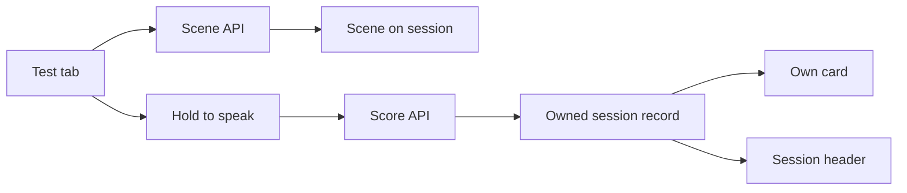

# Requirements

### Overview & Goals
Add a **Test** tab that turns the session's story characters into one real-life conversation. The learner listens to study sentences as spoken lines, then speaks a reply that has to work in that situation. The server scores the spoken transcripts and saves a personal **1–5** grade, with listening and speaking scores beside it.

The grade appears on that learner's own session card and inside the open session. Community sessions stay ungraded.

### Difference from Play
Play is open practice. Test is a fixed check of the study sentences. They share the story cast and hold-to-speak, but they do not share a conversation.

- Play invents four starters when the session opens and accepts any reply. `studyPlayTurn` then writes the next character line, a scene note, and a picture. Those lines only invite the vocabulary.
- Test is one 3–6 beat script, built only when the tab opens and reused on retake. The character speaks the study sentences. The learner does not get a new reply after each answer.
- A listen beat hides the line and asks for the meaning in the UI language. A speak beat shows only a UI-language cue and requires a situated study-language reply. Play shows every line and stays in the study language.
- Play can continue forever and may never touch a given sentence. Test places the studied lines once and stops at Finish.
- Play is rendered inside All. Test is not, so opening the session does not start the exam.

### Scope
#### In Scope
- One live character scene per study session, reused on retake.
- Spoken-transcript scoring of listening+comprehension and reasoning+speaking for the study sentences.
- A personal 1–5 grade plus the two skill scores.
- Showing the latest grade on the owner's card and inside the owned session.

#### Out of Scope
- Pronunciation or audio scoring. Hold-to-speak already turns speech into text; the grade uses that transcript.
- Attempt history. A retake replaces the latest grade.
- Grading Watch, Story, Study, Read, Write, or Play. Those stay practice.
- Writing a grade onto someone else's session, or showing it on a community card.
- A sealed exam. The study sentences are already visible in other tabs, so the Test tab hides lines during the attempt rather than trying to hide them from the network payload.

### User Stories
- As a learner, I want to finish by talking with the session's characters in a real situation, so the grade reflects whether I understood and can use the study sentences.
- As a learner, I want one 1–5 grade with listening and speaking scores, so I can see which ability pulled the result down.
- As a learner, I want that grade on my own session card and inside the session, so I can see it without retaking the test.
- As a learner browsing community sessions, I do not want another person's grade on their card.

### Functional Requirements
- The Test chip is last, after Play, and it is also rendered inside All. Opening All does not auto-play the exam audio.
- Session creation builds the scene once, using the existing cast, and the creation progress includes that step. A retake reuses the scene.
- The scene is one conversation of 10 rounds, not a short quiz. Each round is a listen beat followed by a speak beat, so the attempt always alternates and never ends on a second speaking beat.
- The test opens with a numbered outline of what the learner needs to do in each round. Empty answers cannot advance, and Next stays disabled until there is text.
- A listen beat shows the character portrait and plays the study-language line. The line stays hidden until the learner answers. The learner holds to speak, in the UI language, what the character meant. Repeating the heard line is not comprehension.
- A speak beat shows a short UI-language cue for what the learner needs to do next. The learner holds to speak a reply in the study language. A recitation that does not answer the moment is not a clear reply.
- Finish sends transcripts only. Each beat is judged missed, partial, or clear. Code turns those points into the numbers. The model does not choose the 1–5.
- Bands, for each skill: 0–20% Beginner (1), 21–40% Elementary (2), 41–60% Intermediate (3), 61–80% Advanced (4), 81–100% Native (5).
- The overall grade is the rounded average of the two skill scores, equal weight.
- The result shows the number, label, both skill scores, and a short note. Retake clears the local answers, keeps the same scene, and replaces the grade.
- The grade is saved only for the owning device. A session started in another language does not inherit the old scene or grade.
- A blank or missing answer scores as missed, without a model call.

### Non-Functional Requirements
- The client save payload cannot set or copy a grade.
- A later image, play, or progressive save must not erase the grade or the scene.
- Shared `GET /api/chat/study-sessions/{id}` and the community list must not include the grade.
- New copy is added to all nine `UiStrings` locales.

# Technical Design

### Current Implementation
`StudyScreen.kt` already has All, Watch, Story, Study, Listen, Read, Write, Express, and Play. All renders every mode except itself, so a new mode would appear there unless it is filtered out.

Story characters are designed once in `StudyService.designCharacters` and stored on `StudySessionResponse.characters`. Play already reuses that cast for open role-play through `studyPlayScenarios` and `studyPlayTurn`, but those turns are not scored and are generated eagerly when a session opens.

Listen and Express already judge meaning with a boolean `correct` flag in `QwenStudyClient`. They are practice checks, not a 1–5 scale, and they do not use the characters.

Sessions belong to a device token, not an account. `StudySessionsService.save` replaces the whole record. `GET /api/chat/study-sessions/{id}` is shareable, while community cards come from `listExceptDevice`. Hold-to-speak is `ChatInput`, and its `languageTag` can be the UI language or the study language.

### Key Decisions
- The exam is one scripted scene, not a reuse of the Listen and Express checks. Those checks cannot score a situated reply or produce a stable 1–5.
- Do not reuse `studyPlayScenarios` or `studyPlayTurn`. Those endpoints invent an open chat and do not judge comprehension or a situated reply.
- The model judges each beat as 0, 1, or 2. `StudyExamScoring` maps the points to 1–5 so the bands stay testable and the model cannot invent the grade.
- The scene script lives on `StudySessionResponse.examScene`, like `playScenarios`, so a retake uses the same conversation. The grade does not live in that blob.
- The grade is a sibling `examGrade` on the saved-session record. Only the score endpoint writes it, and only for the owning device. Client saves preserve the existing grade and cannot supply one.
- The scene is generated during session creation, alongside the other creation steps, so the progress list can show it. A retake reuses that scene.
- Speaking is scored from the hold-to-speak transcript. There is no pronunciation model to grade the recording.

### Proposed Changes
Add `POST /api/chat/study/exam/scene` and `POST /api/chat/study/exam/score` beside the existing study routes in `ChatRoutes.kt`.

Scene generation follows the Play prompt style in `QwenStudyClient`: one JSON object, no markdown, study-language spoken lines, UI-language stage directions. It must use the saved cast (`main`, and `secondary` when present) and must not invent extra people. If character design has not finished, Test waits. If the cast is still empty, the server uses one fallback speaker so the exam is not blocked. Listen lines are the study sentences, either verbatim or inside a short natural frame that still contains the sentence. Speak cues require the learner to use that sentence's meaning in the situation.

The client stores the returned scene with the existing `persistStudySession` path. Score accepts only the owned session id and the transcripts. It loads the stored scene, ignores any expected meaning posted by the client, and writes `examGrade`. Per-beat notes are returned for the result screen and are not stored.

`StudySessionsService.save` keeps `existing.examGrade`. If an incoming session omits `examScene` and the stored session has one, the stored scene is kept. `toSummaryApi` includes the grade only for the owner list. `get` nulls it unless the device hash matches. `listExceptDevice` does not select it.

On the client, `StudySessionMode.TEST` is excluded from the All render list. The tab walks the beats in order, plays listen lines through the existing sentence TTS helper, and switches `ChatInput.languageTag` to the UI language for listen answers and `textLanguageTag` for speak answers. Finish updates the in-memory owned summary so the card changes without a reload. `startStudyInAnotherLanguage` starts a new study from text, so it must not copy `examScene` or `examGrade`.

### Data Models / Contracts
```kotlin
enum class StudyExamBeatKind { LISTEN, SPEAK }

data class StudyExamBeat(
    val id: String,
    val kind: StudyExamBeatKind,
    val speakerId: String,
    val speakerName: String,
    val line: String? = null,
    val prompt: String,
    val expectedMeaning: String,
    val sourceSentence: String,
)

data class StudyExamScene(
    val id: String,
    val setting: String,
    val beats: List<StudyExamBeat> = emptyList(),
)

data class StudyExamGrade(
    val overall: Int,
    val listening: Int,
    val speaking: Int,
    val feedback: String,
    val scoredAt: Long,
)
```
`StudySessionResponse` gains `examScene: StudyExamScene? = null`. `SavedStudySession` and `SavedStudySessionSummary` gain `examGrade: StudyExamGrade? = null`. The score request is the session id plus `{ beatId, transcript }` answers. The response is the grade plus ephemeral `{ beatId, points, feedback }` rows.

`StudyExamScoring.level(points, maxPoints)` uses integer percent: `<=20 -> 1`, `<=40 -> 2`, `<=60 -> 3`, `<=80 -> 4`, else `5`. Empty max is 1. Overall is `round((listening + speaking) / 2.0)` clamped to 1–5. If one skill has no beats, overall equals the other skill. The scene prompt still requires both skills.

### Architecture Diagram


### File Structure
- `core/src/commonMain/kotlin/apap/oneverandah/api/ChatApiModels.kt` — scene, beat, grade, and request models.
- `server/src/main/kotlin/apap/oneverandah/chat/StudyExamScoring.kt` — band math.
- `server/src/main/kotlin/apap/oneverandah/chat/QwenStudyClient.kt` — scene and beat-judgment prompts plus parsers.
- `server/src/main/kotlin/apap/oneverandah/chat/StudyService.kt` — generate and score.
- `server/src/main/kotlin/apap/oneverandah/routes/ChatRoutes.kt` — the two exam routes.
- `server/src/main/kotlin/apap/oneverandah/chat/StudySessionsService.kt` and `ArangoStudySessionsRepository.kt` — preserve and project the owner-only grade.
- `app/web/src/jsMain/kotlin/apap/oneverandah/api/ChatApi.kt` — client calls.
- `app/web/src/jsMain/kotlin/apap/oneverandah/screens/StudyScreen.kt` — Test tab, header chip, and card badge.
- `app/web/src/jsMain/kotlin/apap/oneverandah/Styles.kt` and `i18n/Localization.kt` — badge and all nine locales.

### Risks
- Transcript quality limits the speaking score. A failed recognition should stay editable in the field before the learner continues, using the existing `ChatInput` text.
- A stale progressive save can wipe new session fields. The save merge must keep a stored scene and must never accept a client grade.
- Rendering Test inside All must not auto-play the listen line, or opening the session would start the exam audio.
- Calling `studyPlayTurn` from Test would turn the exam into another Play chat. The Test tab only calls the scene and score endpoints.
- Character portraits may still be loading. The beat can render the name first and attach `imageUrl` when it arrives.
- The model may add an overall number. Parsers ignore every key except the beat points and feedback.

# Testing

### Validation Approach
Lock the grade math and persistence in unit and route tests. Check the Test tab through the existing web test style for pure helpers, and by walking the beat rules against fixture scenes. No live model call is required for the band, privacy, or save-merge checks.

### Key Scenarios
- A one-sentence fixture becomes a 3-beat scene with both a listen beat and a speak beat, using the saved character name.
- A six-sentence fixture stays one conversation and does not become twelve quiz items.
- Full points on both skills return 5 / 5 / 5. Half points return 3. Mixed 4 and 2 return overall 3.
- Finish with an owned session id stores the grade and returns it on the owner list and owner `get`.
- The same scene scored again replaces `examGrade` and does not create a second record.
- A community list response and a non-owner `get` omit the grade.
- The owner's card and session header render the number only when `examGrade` is present.

### Edge Cases
- A blank transcript scores 0 and does not call the model.
- An unknown beat id in the score request is ignored.
- A client save that includes a forged `examGrade`, or omits `examScene`, keeps the stored grade and scene.
- A session with no characters still produces a scene with one fallback speaker.
- A session opened from another device can play the scene locally but cannot write the grade onto the shared record.
- Starting the study in another language does not carry the previous scene or grade.

### Test Changes
- Add parser cases beside the existing ones in `QwenStudyClientTest`.
- Add band cases for `StudyExamScoring`.
- Extend `StudySessionsServiceTest` and `StudySessionsRoutesTest` for grade preservation, owner projection, and community omission.
- Extend `ChatApiModelsTest` so missing `examScene` and `examGrade` still decode on older payloads.
- Add a small web helper test if beat-walk or badge visibility is extracted as a pure function. Do not add a browser test.

# Delivery Steps

### ✓ Step 1: Add exam contracts and owner-only grade storage
A study session can store one scene script, and only the owning device can keep or read a grade.

- Add `StudyExamScene`, `StudyExamBeat`, `StudyExamGrade`, and the score request models in `ChatApiModels.kt`, with defaults so older saved sessions still decode.
- Add `examScene` to `StudySessionResponse` and `examGrade` to the saved-session record, `SavedStudySession`, and `SavedStudySessionSummary`.
- In `StudySessionsService.save`, preserve the stored grade and preserve a stored scene when the incoming payload omits it.
- Project `examGrade` only from the owner list and owner `get`. Leave it out of `listExceptDevice` and null it for every other device.
- Cover older-payload decoding, save preservation, and community omission in `ChatApiModelsTest`, `StudySessionsServiceTest`, and `StudySessionsRoutesTest`.

### ✓ Step 2: Generate and score the live character scene
The server can turn a study session into one character conversation and turn spoken transcripts into a 1–5 grade with two skill scores.

- Add `POST /api/chat/study/exam/scene` and `POST /api/chat/study/exam/score` in `ChatRoutes.kt`, following the existing study-route style.
- Add a JSON-only scene prompt and parser in `QwenStudyClient` that uses the saved cast, keeps spoken lines in the study language, and builds one 3–6 beat situation rather than one quiz item per sentence.
- Add a beat-judgment prompt that returns only 0, 1, or 2 and a short UI-language note. Treat a repeated listen line, a wrong language, or an off-situation recitation as not clear.
- Put the band math in `StudyExamScoring` and use it from `StudyService` so the model cannot choose the 1–5.
- Score against the stored scene for the owning device, write `examGrade`, and return per-beat notes without storing them.
- Test the parser and the band boundaries without a live model call.

### ✓ Step 3: Walk the scene in the Test tab
The Test tab plays the character scene and collects one spoken answer per beat.

- Add `StudySessionMode.TEST` after Play, exclude it from the All render list, and add the tab label plus result copy to all nine `UiStrings` locales.
- Generate the scene only when Test opens and the session has no `examScene`, then persist it through the existing `persistStudySession` path.
- Render the setting, character portrait, and one beat at a time. Play a listen line with the existing TTS helper while hiding its text, and show only the UI-language cue on a speak beat.
- Reuse `ChatInput` hold-to-speak, with the UI language for listen answers and `textLanguageTag` for speak answers. Keep the transcript editable before the learner continues.
- On Finish, send transcripts only, show the number, label, skill scores, and note, and let Retake clear local answers without generating a new scene.
- Do not call `studyPlayTurn`, render the four Play cards, or generate a character reply after each answer.
- Do not copy the scene or grade when `startStudyInAnotherLanguage` starts a new study.

### ✓ Step 4: Show the personal grade on the card and in the session
The latest grade is visible on the learner's own session card and inside the open session, and nowhere on a community session.

- Add a number badge to `StudySessionCard` when `examGrade` is present, without colliding with the card's rename and delete actions.
- Show the same grade in the owned session header, and keep the full breakdown on the Test result.
- Update the in-memory owned summary when scoring finishes so the open card changes without a reload.
- Leave community cards and unowned opens ungraded even if a shared session payload contains a scene.
- Add the badge style in `Styles.kt` and cover badge visibility with the existing pure helper test style in `StudySessionsListTest`.